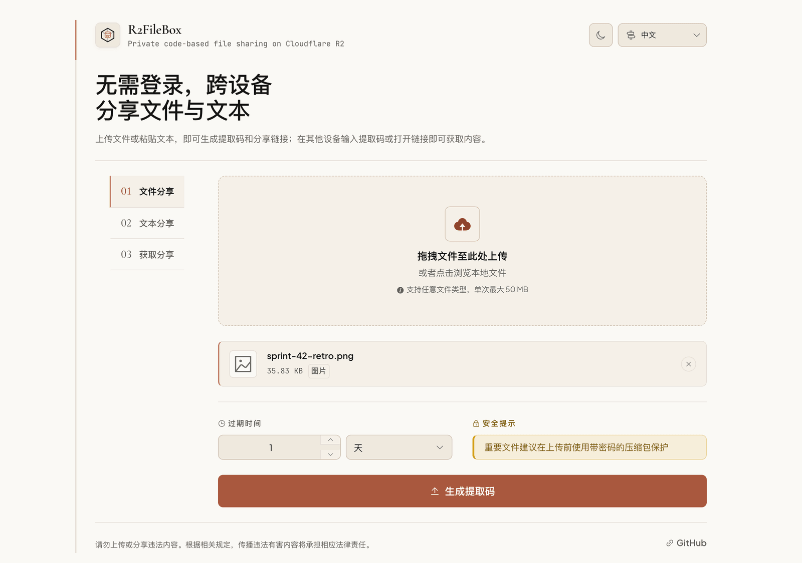
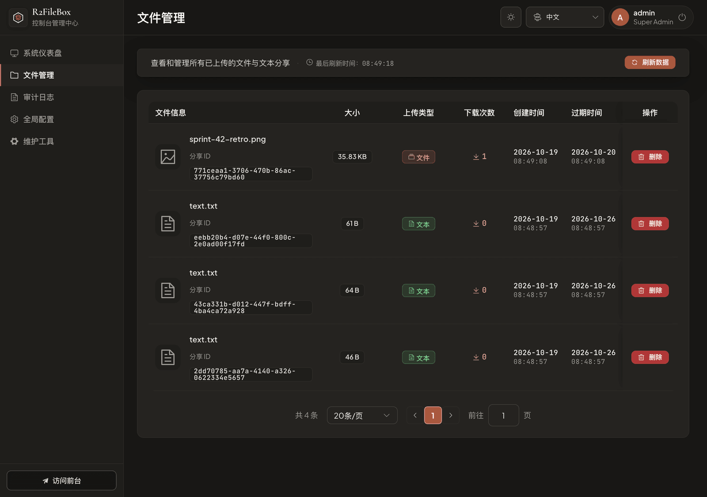
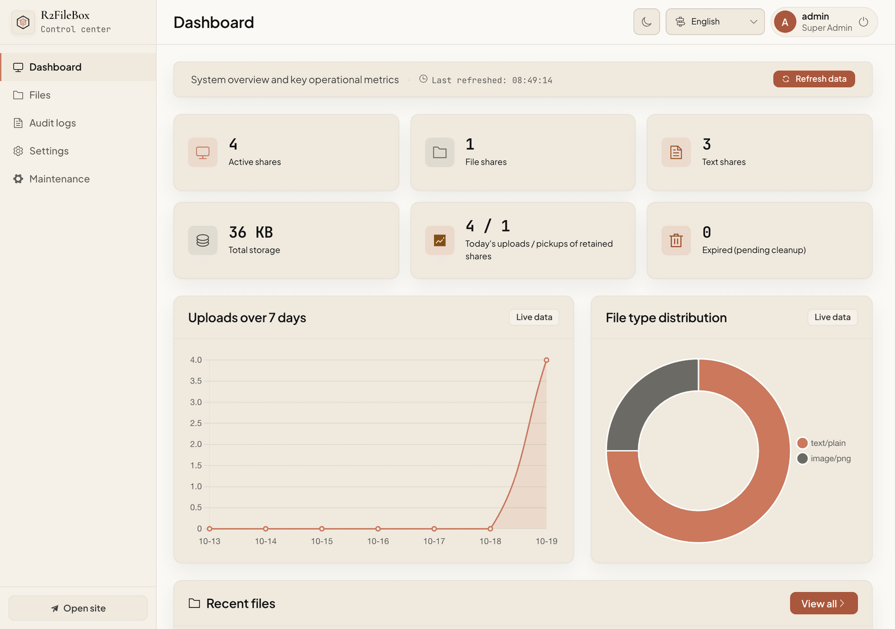
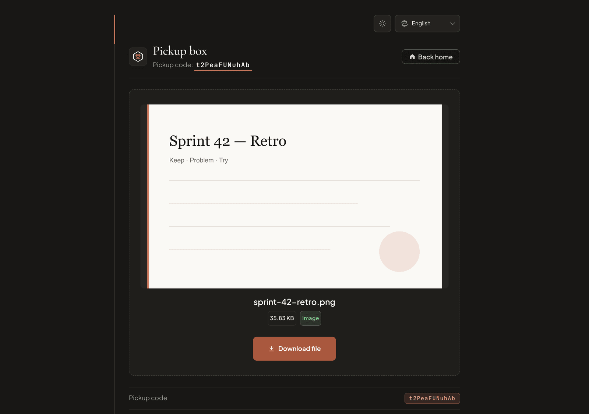
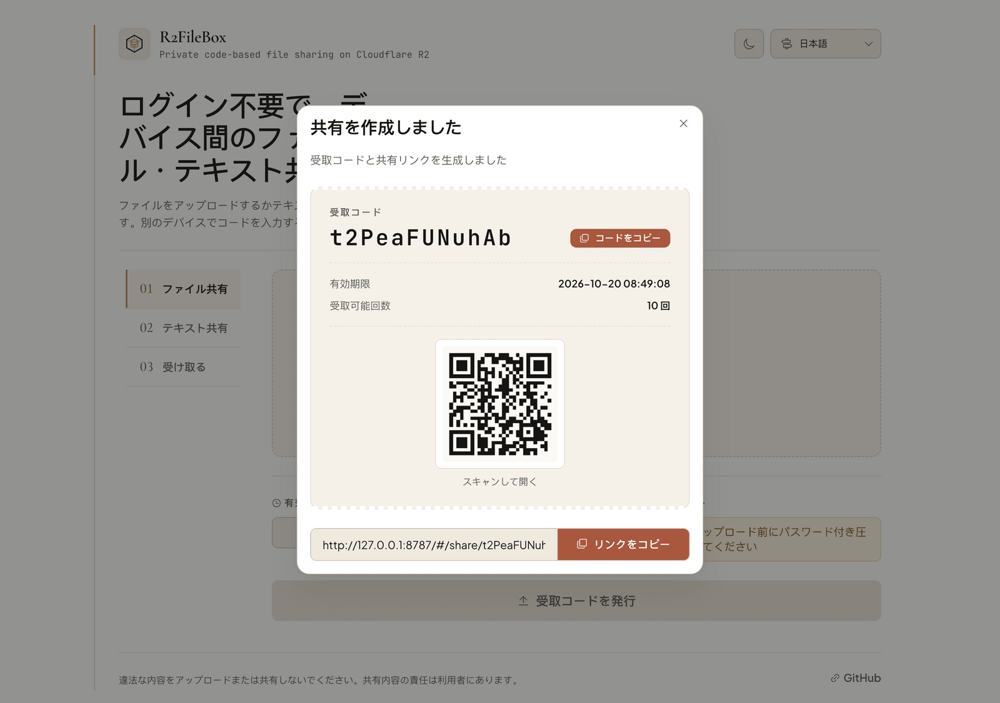
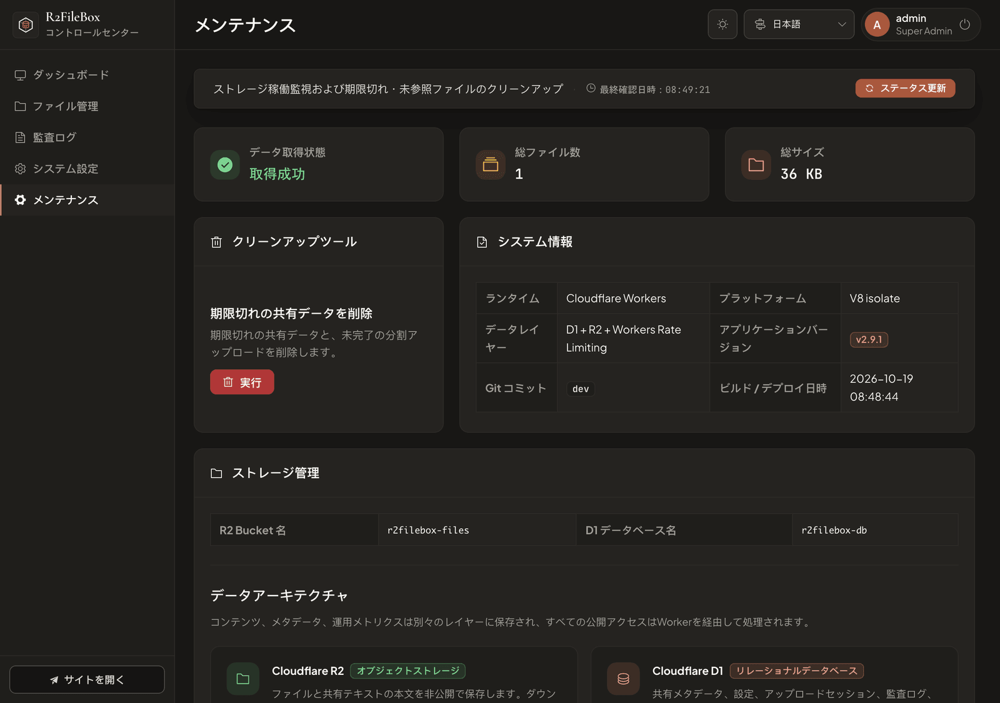

# R2FileBox

**Share files with a short code.**

A file and text sharing app you host in your own Cloudflare account. Upload, set an expiry, and send a code, link, or QR code. No sign-up is needed to send or receive.

Cloudflare Workers + R2 + D1 · English / 简体中文 / 日本語 · Light & dark themes

[](https://github.com/workHMZ/r2filebox/releases/latest)
[](https://github.com/workHMZ/r2filebox/actions/workflows/ci.yml)
[](https://github.com/workHMZ/r2filebox/actions/workflows/codeql.yml)
[](./LICENSE)

[English](#english) · [简体中文](#中文) · [日本語](#日本語) · [Preview](#preview) · [Deploy](#deploy)

[](https://deploy.workers.cloudflare.com/?url=https://github.com/workHMZ/r2filebox)

## Preview

https://github.com/user-attachments/assets/1117cc2e-2c63-4de9-aacf-498f77c3822a

<table>
  <thead>
    <tr>
      <th width="50%">Light · 浅色 · ライト</th>
      <th width="50%">Dark · 深色 · ダーク</th>
    </tr>
  </thead>
  <tbody>
    <tr>
      <td width="50%" align="center" valign="top">
        <a href="./docs/screenshots/v2.9.1/home-file-share.png"></a><br>
        <strong>文件分享</strong><br>中文 · 浅色
      </td>
      <td width="50%" align="center" valign="top">
        <a href="./docs/screenshots/v2.9.1/admin-files.png"></a><br>
        <strong>文件管理</strong><br>中文 · 深色
      </td>
    </tr>
    <tr>
      <td width="50%" align="center" valign="top">
        <a href="./docs/screenshots/v2.9.1/admin-dashboard.png"></a><br>
        <strong>Dashboard</strong><br>English · Light
      </td>
      <td width="50%" align="center" valign="top">
        <a href="./docs/screenshots/v2.9.1/pickup-file.png"></a><br>
        <strong>Pickup &amp; preview</strong><br>English · Dark
      </td>
    </tr>
    <tr>
      <td width="50%" align="center" valign="top">
        <a href="./docs/screenshots/v2.9.1/share-created.png"></a><br>
        <strong>受取コード・QR</strong><br>日本語 · ライト
      </td>
      <td width="50%" align="center" valign="top">
        <a href="./docs/screenshots/v2.9.1/admin-maintenance.png"></a><br>
        <strong>メンテナンス・ストレージ</strong><br>日本語 · ダーク
      </td>
    </tr>
  </tbody>
</table>

## English

### How it works

1. Drop a file into the page or paste some text.
2. Choose an expiry and pickup limit, then send the code, link, or QR code.
3. The recipient enters the code, opens the link, or scans the QR code to download the file or read the text.

The admin console manages shares, limits, and upload settings without a redeploy. The app is installable as a PWA; supported browsers and operating systems can receive text and links from the system share menu. File share targets are not supported.

### What is optimized

<details>
<summary>Resumable uploads, verified deduplication, download sessions, and O(1) quota checks</summary>

| Improvement | Implementation |
|---|---|
| **Resume interrupted uploads** | 8 MiB parts, with completed-part records saved in browser storage. Reselect the original file in the same browser within the 24-hour upload session; an interrupted part is sent again. |
| **Skip repeat transfers** | A valid capability from a previous successful upload lets the browser reuse a stored file. The Worker signs SHA-256 part receipts and verifies the full-file fingerprint at completion. There is no public hash-existence lookup. |
| **Count pickups fairly** | One pickup opens a download session for up to one hour, capped by share expiry. Video seeking, Range requests, and retries within that session use no extra pickups. |
| **Store verified duplicates once** | Shares reuse an R2 object while keeping independent codes, expiry, and limits. Files are reclaimed after their last reference is removed; hourly cleanup retains failed deletions for retry. |
| **Read storage usage in O(1)** | D1 triggers maintain a usage counter, including upload reservations and pending cleanup. Quota checks avoid scanning shares; other dashboard statistics still use aggregation. |
| **Limit abuse at two levels** | Workers Rate Limiting filters requests at the edge; D1 window counters enforce shared limits across nodes. Application audit and rate-limit records use IP hashes. |

Resume requires retained browser storage. Instant-upload capabilities last 30 days and work only while the matching file remains available.

**Stack:** Vue 3 + Element Plus, Hono on Workers, a private R2 bucket, D1, and Analytics Engine. The frontend is served through Workers Static Assets.

**Code:** [Upload & download](./worker/src/routes/share.ts) · [Browser upload state](./frontend/src/components/upload/FileUpload.vue) · [Storage accounting](./worker/migrations/0003_instant_upload.sql) · [Cleanup](./worker/src/lib/cleanup.ts) · [Rate limits](./worker/src/lib/rate-limit.ts)

</details>

### Deploy

First [enable R2](https://developers.cloudflare.com/r2/get-started/) and complete Cloudflare's payment setup. R2 includes a free allowance; usage beyond it is billed.

Use [Deploy to Cloudflare](https://deploy.workers.cloudflare.com/?url=https://github.com/workHMZ/r2filebox) with:

```text
Build command:  npm run build
Deploy command: npm run deploy
```

| Secret | Value |
|---|---|
| `ADMIN_PASSWORD` | Choose and save a password, 16–4096 characters. |
| `CODE_HASH_PEPPER` | Generate with `openssl rand -hex 32`. |
| `SESSION_SECRET` | Run `openssl rand -hex 32` again for a separate value. |

Keep the generated secrets stable: changing `CODE_HASH_PEPPER` invalidates existing pickup codes; changing `SESSION_SECRET` invalidates sessions and signed tokens.

`ADMIN_USERNAME` defaults to `admin`. Turnstile is off by default. Set `TURNSTILE_SECRET_KEY` in the Worker's secrets, then enter the matching Site Key and enable Turnstile in the admin console.

<details>
<summary>CLI deployment and local development</summary>

Use Node.js 24 (`>=24.22.1 <25`; the pinned version is in [.nvmrc](./.nvmrc)).

```bash
git clone https://github.com/workHMZ/r2filebox.git
cd r2filebox
npm ci
```

**Deploy:** run `npm run deploy:cf`. The CLI creates or reuses R2 and D1, saves the local database binding, stores the admin password as a PBKDF2 hash, runs migrations, and deploys. Existing secrets are preserved by default.

**Run locally:**

```bash
cp .dev.vars.example .dev.vars   # Fill in the three required values
npm run build
npm run db:migrate:local
npm run dev                     # http://localhost:8787
```

Rebuild after frontend changes. Keep `.dev.vars` out of Git.

```bash
npm run verify
npm run deploy:dry-run
```

[CI](./.github/workflows/ci.yml) checks configuration, assets, translations, types, tests, and the deployment bundle. Actions are pinned to commit SHAs; npm caching and cancellation of superseded runs reduce repeated work. [CodeQL](./.github/workflows/codeql.yml) scans JavaScript/TypeScript and GitHub Actions; [Dependabot](./.github/dependabot.yml) checks dependency updates weekly.

</details>

> [!WARNING]
> Apply database migrations before deploying the Worker. After the v2.5.0 migration, do not roll back to v2.4.x or earlier: older cleanup code can delete files still used by other shares.

### Defaults

| Setting | Default |
|---|---|
| File size | 50 MiB; adjustable from 1–95 MiB |
| Storage budget | 8 GiB soft limit for managed content and upload reservations |
| Share expiry | 24 hours; maximum 168 hours by default, adjustable in admin |
| Pickups per share | 10 |
| Cleanup | Hourly |

Reaching a pickup limit blocks new pickups; an already issued, valid download session remains usable. Expired shares are removed by scheduled cleanup.

**Privacy:** R2 is private, pickup codes are stored as hashes, and downloads pass through the Worker. The Worker can read uploaded content; end-to-end encryption is not provided. Encrypt sensitive files before uploading.

---

## 中文

**传一个文件，发一个取件码。**

部署在你自己的 Cloudflare 账户中，用来分享文件和文本。支持取件码、链接、二维码，分享和取件都无需注册。

### 怎么用

1. 拖入文件，或粘贴文本。
2. 选择有效期和取件次数，把取件码、链接或二维码发给对方。
3. 对方输入取件码、打开链接或扫描二维码，即可下载文件或查看文本。

后台可管理分享、调整限制和上传设置，无需重新部署。支持安装为 PWA；在兼容的浏览器和系统中，可从系统分享菜单接收文本和链接，暂不接收文件。

### 做了哪些优化

<details>
<summary>断点续传、验证去重、下载会话与 O(1) 配额检查</summary>

| 优化 | 具体实现 |
|---|---|
| **断点续传** | 按 8 MiB 分片，在浏览器记录已完成分片。24 小时上传会话内，在同一浏览器重选原文件即可恢复；中断的那一片需重传。 |
| **重复文件秒传** | 浏览器凭上次成功上传获得的有效签名凭据复用文件。Worker 为各分片的 SHA-256 签发收据，并在上传完成时验证完整文件指纹；不提供公开的哈希存在性查询。 |
| **按取件计数** | 一次取件建立最长 1 小时、且不超过分享有效期的下载会话。会话内的视频拖动、Range 请求和重试不额外扣次数。 |
| **文件去重，分享独立** | 经验证的相同文件复用一个 R2 对象，各分享保留独立取件码、期限和次数。最后一个引用移除后才回收实体；每小时清理，失败记录保留重试。 |
| **O(1) 容量读取** | D1 触发器维护容量汇总，包含上传预留与待回收占用。配额检查无需扫描分享表，其他后台统计仍需聚合。 |
| **双层限流** | Workers Rate Limiting 在边缘过滤请求，D1 时间窗计数器执行跨节点共享限制。应用的审计与限流记录使用 IP 哈希。 |

续传依赖浏览器保留的本地记录；秒传凭据有效期为 30 天，且对应文件须仍然可用。

**技术栈：** Vue 3 + Element Plus、Hono + Workers、私有 R2 桶、D1、Analytics Engine；前端由 Workers Static Assets 提供。

**源码：** [上传与下载](./worker/src/routes/share.ts) · [浏览器上传状态](./frontend/src/components/upload/FileUpload.vue) · [容量统计](./worker/migrations/0003_instant_upload.sql) · [清理](./worker/src/lib/cleanup.ts) · [限流](./worker/src/lib/rate-limit.ts)

</details>

### 部署

先[开通 R2](https://developers.cloudflare.com/r2/get-started/) 并完成 Cloudflare 支付设置。R2 有免费额度，超出后按用量计费。

点击 [Deploy to Cloudflare](https://deploy.workers.cloudflare.com/?url=https://github.com/workHMZ/r2filebox)，填写：

```text
Build command:  npm run build
Deploy command: npm run deploy
```

| 密钥 | 填什么 |
|---|---|
| `ADMIN_PASSWORD` | 自设 16–4096 字符的管理员密码，保存好。 |
| `CODE_HASH_PEPPER` | 执行 `openssl rand -hex 32` 生成。 |
| `SESSION_SECRET` | 再单独执行一次 `openssl rand -hex 32`。 |

保留生成的密钥：更换 `CODE_HASH_PEPPER` 会使已有取件码失效，更换 `SESSION_SECRET` 会使会话与签名令牌失效。

`ADMIN_USERNAME` 默认为 `admin`。Turnstile 默认关闭。先在 Worker 的 Secrets 中设置 `TURNSTILE_SECRET_KEY`，再到应用后台填写对应 Site Key 并启用验证。

<details>
<summary>命令行部署与本地开发</summary>

使用 Node.js 24（`>=24.22.1 <25`；固定版本见 [.nvmrc](./.nvmrc)）。

```bash
git clone https://github.com/workHMZ/r2filebox.git
cd r2filebox
npm ci
```

**部署：** 执行 `npm run deploy:cf`。脚本会创建或复用 R2 和 D1、写入本地数据库绑定、将管理员密码以 PBKDF2 哈希保存，再执行迁移和部署。默认保留已有密钥。

**本地运行：**

```bash
cp .dev.vars.example .dev.vars   # 填好三个必填值
npm run build
npm run db:migrate:local
npm run dev                     # http://localhost:8787
```

修改前端后需重新构建，勿提交 `.dev.vars`。

```bash
npm run verify
npm run deploy:dry-run
```

[CI](./.github/workflows/ci.yml) 检查配置、资源、翻译、类型、测试和部署包。Actions 固定提交 SHA，npm 缓存与旧任务自动取消减少重复执行。[CodeQL](./.github/workflows/codeql.yml) 扫描 JavaScript/TypeScript 与 GitHub Actions，[Dependabot](./.github/dependabot.yml) 每周检查依赖更新。

</details>

> [!WARNING]
> 数据库迁移须先于 Worker 部署。应用 v2.5.0 迁移后，请勿回退到 v2.4.x 或更早版本：旧清理逻辑可能删除其他分享仍在使用的文件。

### 默认设置

| 设置 | 默认值 |
|---|---|
| 单文件大小 | 50 MiB，后台可调 1–95 MiB |
| 存储预算 | 8 GiB 软上限，计入托管内容和上传预留 |
| 分享有效期 | 24 小时；默认上限 168 小时，后台可调 |
| 每份分享取件次数 | 10 次 |
| 自动清理 | 每小时 |

次数用尽后停止新取件，已签发且仍有效的下载会话可继续使用；过期分享由定时任务清理。

**隐私边界：** R2 桶不公开，取件码仅存哈希，下载经过 Worker。Worker 可以读取上传内容，本项目不提供端到端加密；敏感文件请先在本地加密。

---

## 日本語

**ファイルを送って、受取コードを渡す。**

自分の Cloudflare アカウントにデプロイして使う、ファイル・テキスト共有アプリです。受取コード、リンク、QR コードに対応し、共有も受け取りも登録不要です。

### 使い方

1. ファイルをドラッグするか、テキストを貼り付けます。
2. 有効期限と受取回数を選び、コード・リンク・QR コードを相手に送ります。
3. 相手はコードを入力するか、リンクを開くか、QR コードを読み取って、ファイルのダウンロードやテキストの閲覧ができます。

共有や各種上限、アップロード設定は管理画面から変更でき、再デプロイは不要です。PWA としてインストールでき、対応するブラウザ・OS では共有メニューからテキストとリンクを受信できます。ファイルの受信には対応していません。

### 実装の工夫

<details>
<summary>アップロード再開・検証付き重複排除・ダウンロードセッション・O(1) 容量確認</summary>

| 最適化 | 実装 |
|---|---|
| **中断したアップロードを再開** | 8 MiB ごとに分割し、完了したパートの情報をブラウザに記録。24 時間のアップロードセッション内に、同じブラウザで元のファイルを選び直すと再開します。中断したパートは再送します。 |
| **同じファイルの再送を省略** | 前回のアップロード成功時に発行された有効な署名付きトークンで、保存済みファイルを再利用。Worker が各パートの SHA-256 に署名付きレシートを発行し、完了時にファイル全体の指紋を検証します。ハッシュの存在を照会する公開 API は設けていません。 |
| **受け取り単位で回数を管理** | 1 回の受け取りで、共有期限を超えない最長 1 時間のダウンロードセッションを発行。セッション内の動画シーク、Range リクエスト、再試行では回数を追加消費しません。 |
| **ファイルを重複排除、共有は個別管理** | 検証済みの同一ファイルは R2 オブジェクトを再利用し、コード・期限・回数は共有ごとに保持。最後の参照がなくなると回収対象になり、毎時の処理で削除に失敗した分は再試行します。 |
| **容量を O(1) で取得** | D1 トリガーがアップロード予約分や回収待ちを含む容量カウンターを更新。上限確認で共有テーブルを走査する必要がなく、ほかの管理画面の統計には集計処理を使います。 |
| **二段階のレート制限** | Workers Rate Limiting でエッジのリクエストを制限し、D1 の時間窓カウンターでノード間の共通上限を適用。アプリの監査・レート制限記録には IP ハッシュを使います。 |

再開にはブラウザ内の記録が必要です。再送を省略するトークンの有効期間は 30 日で、対応するファイルが引き続き利用可能な場合に使えます。

**技術構成：** Vue 3 + Element Plus、Hono + Workers、非公開 R2 バケット、D1、Analytics Engine。フロントエンドは Workers Static Assets から配信します。

**コード：** [アップロードとダウンロード](./worker/src/routes/share.ts) · [ブラウザのアップロード状態](./frontend/src/components/upload/FileUpload.vue) · [容量集計](./worker/migrations/0003_instant_upload.sql) · [回収](./worker/src/lib/cleanup.ts) · [レート制限](./worker/src/lib/rate-limit.ts)

</details>

### デプロイ

先に [R2 を有効化](https://developers.cloudflare.com/r2/get-started/)し、Cloudflare の支払い設定を完了してください。R2 には無料枠があり、超過分は従量課金です。

[Deploy to Cloudflare](https://deploy.workers.cloudflare.com/?url=https://github.com/workHMZ/r2filebox) を開き、次を設定します。

```text
Build command:  npm run build
Deploy command: npm run deploy
```

| シークレット | 設定値 |
|---|---|
| `ADMIN_PASSWORD` | 16–4096 文字の管理者パスワードを決め、安全に保管します。 |
| `CODE_HASH_PEPPER` | `openssl rand -hex 32` で生成します。 |
| `SESSION_SECRET` | `openssl rand -hex 32` をもう一度実行し、別の値を生成します。 |

生成したシークレットは維持してください。`CODE_HASH_PEPPER` を変更すると既存の受取コードが、`SESSION_SECRET` を変更するとセッションと署名付きトークンが無効になります。

`ADMIN_USERNAME` の既定値は `admin` です。Turnstile は既定で無効です。Worker のシークレットに `TURNSTILE_SECRET_KEY` を設定し、アプリの管理画面で対応する Site Key を入力して有効化します。

<details>
<summary>CLI デプロイとローカル開発</summary>

Node.js 24（`>=24.22.1 <25`）を使用します。固定バージョンは [.nvmrc](./.nvmrc) を参照してください。

```bash
git clone https://github.com/workHMZ/r2filebox.git
cd r2filebox
npm ci
```

**デプロイ：** `npm run deploy:cf` を実行します。CLI が R2 と D1 の作成・再利用、ローカルのデータベース設定、管理者パスワードの PBKDF2 ハッシュ保存、マイグレーション、デプロイを進めます。既存のシークレットは既定で維持します。

**ローカルで実行：**

```bash
cp .dev.vars.example .dev.vars   # 必須の 3 項目を設定
npm run build
npm run db:migrate:local
npm run dev                     # http://localhost:8787
```

フロントエンドの変更後は再ビルドしてください。`.dev.vars` はコミットしないでください。

```bash
npm run verify
npm run deploy:dry-run
```

[CI](./.github/workflows/ci.yml) で設定・アセット・翻訳・型・テスト・デプロイ用バンドルを検証します。Actions はコミット SHA で固定し、npm キャッシュと古い実行の自動キャンセルで重複処理を抑えます。[CodeQL](./.github/workflows/codeql.yml) は JavaScript/TypeScript と GitHub Actions を解析し、[Dependabot](./.github/dependabot.yml) が毎週依存関係の更新を確認します。

</details>

> [!WARNING]
> データベースのマイグレーションは Worker のデプロイ前に適用してください。v2.5.0 のマイグレーション後は v2.4.x 以前へ戻さないでください。古い回収処理が、ほかの共有で使用中のファイルを削除する可能性があります。

### 既定値

| 設定 | 既定値 |
|---|---|
| ファイルサイズ | 50 MiB。管理画面で 1–95 MiB に変更可 |
| ストレージ容量 | 管理対象データとアップロード予約分を含む 8 GiB のソフト上限 |
| 共有の有効期限 | 24 時間。既定の上限は 168 時間で、管理画面から変更可 |
| 共有ごとの受取回数 | 10 回 |
| 自動回収 | 毎時 |

回数上限に達すると新規の受け取りを停止しますが、発行済みの有効なダウンロードセッションは引き続き利用できます。期限切れの共有は定期処理で回収します。

**プライバシー：** R2 バケットは非公開で、受取コードはハッシュとして保存し、ダウンロードは Worker を経由します。Worker はアップロード内容を読み取れます。エンドツーエンド暗号化には対応していないため、機密ファイルはアップロード前に暗号化してください。

---

## License · 许可 · ライセンス

**LGPL-3.0-or-later** · [LICENSE](./LICENSE) · [THIRD_PARTY_NOTICES.md](./THIRD_PARTY_NOTICES.md)

Inspired by [FileCodeBox](https://github.com/vastsa/FileCodeBox) and its [Go implementation](https://github.com/zy84338719/FileCodeBox). An independent Cloudflare Workers implementation.

灵感来自上述项目，本项目为独立的 Cloudflare Workers 实现。
上記プロジェクトに着想を得た、独立した Cloudflare Workers 実装です。
